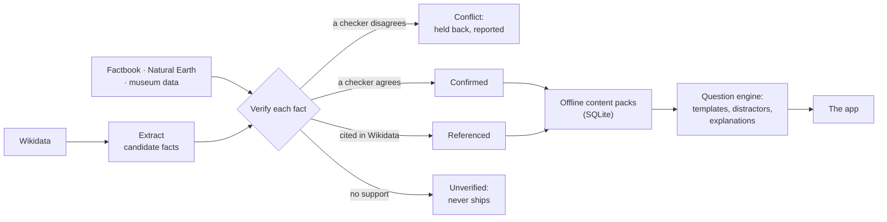

# Atlas

An offline atlas of general knowledge that you play: countries, cities, rivers, languages and artworks, learned through quizzes, map games and a daily puzzle. *Atlas is a working name.*

*Showcase repo. The source is private while the app gets ready for the stores; I’m happy to walk through the code.*

## The hard part is the facts

A quiz app is only as good as its answers, and a wrong answer offered as the right one does real harm. So the content does not come from a model. A pipeline builds it from open sources and checks every fact before it ships.

- **Sources.** Wikidata supplies the entities and their properties. The CIA World Factbook, Natural Earth and two museum collections (the Met and the Art Institute of Chicago) act as independent checkers.
- **Verification.** Every candidate fact gets one of four outcomes. If a checker disagrees, it is a *conflict* and does not ship. If a checker agrees, it is *confirmed*. If no checker covers it but Wikidata cites a real reference, it is *referenced*. Anything else is *unverified* and never ships.
- **Lists ship whole or not at all.** If one value of a multi-valued property (a country’s neighbours, say) fails, the whole list is held back. A partial list misleads, and its missing values could turn up as “wrong” options in a question.
- **A vandalism guard.** Each Wikidata label is compared with the title of the matching Wikipedia article, which has far more watchers. A label is flagged only when the entity’s other names cannot explain the difference.
- **Reports, not silence.** Each build writes coverage, conflict and missing-value reports, so a fact that is held back is a line in a CSV that can be fixed.

## Playing it

The question engine turns verified facts into questions from templates, picks plausible wrong options and explains each answer. On top of it sit the ways to play:

- a **daily puzzle** that every player shares;
- a **trainer** that schedules reviews with spaced repetition (FSRS);
- a **ladder** of 15 rising levels with safe points;
- **pass-and-play** for 2 to 8 players on one phone;
- **complete the set** (name every member of a group), a clue-based **detective** game, a map **conquest** game, and a guessing game where each guess shows how close you are on population, continent and distance.

Everything runs offline from downloaded packs.

## How it was built

I designed it and directed the work; Claude Code agents wrote most of the code in parallel git worktrees, with review agents and the test suite as the gate before each merge. The project also carries a launch-readiness review covering EU Digital Services Act trader rules, data licences and attribution, privacy, and how the map shows disputed borders.

| | |
|---|---|
| Timeline | 373 commits, 14 to 26 October 2026 |
| Code | ~50,000 lines of TypeScript across the pipeline, the engine, the game modes and the app |
| Tests | 126 test files (Vitest) |
| Stack | TypeScript, React Native (Expo), SQLite, d3-geo (Equal Earth projection) |
